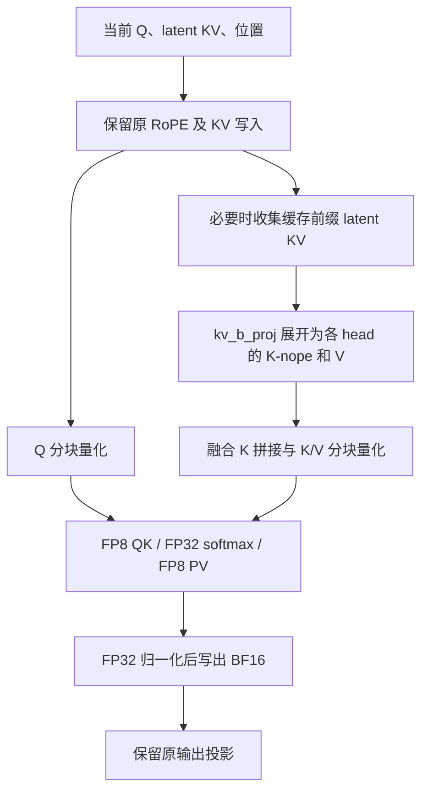
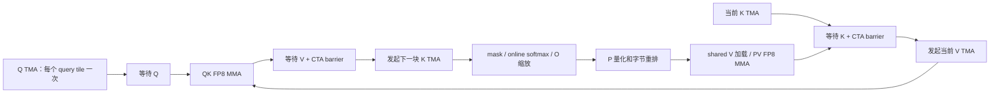

# RTX PRO 5000 优化交付说明与实现细节

> 当前发布基于社区 v0.5.17 的 29481685，只包含 sjtushenhai 的优化提交；
> 同事的 14 个内部基础提交及其改动已移除。下文性能、配置和源码哈希是
> 之前组合环境的历史记录，不能据此宣称当前社区基线分支已达到 51%～52%。
> 当前提交与验证范围见 [社区基线发布说明](OPTIMIZATION_COMMITS_20261010.md)。

本文汇总本工作区的优化代码、配置、性能证据和适用边界。性能数据日期：2026-10-09；分项 Git 交付更新：2026-10-10。
实测 SGLang 基点为 `b1478c429`，来自原工作区分支 `mhy/v0.5.17-hyg-ob`。
当前发布基点是社区 v0.5.17 的 `29481685462732237d80d86076d6563e1f658102`。
历史实测环境另含 14 个内部基础提交；它们不属于本次发布内容。
当前分支只迁移本次 sjtushenhai 的优化补丁，尚未重新进行服务性能压测。
提交索引、目标分支与验证记录见 [分项 Git 交付](OPTIMIZATION_COMMITS_20261010.md)。
FlashInfer 研究目录为 `/sgl-workspace/flashinfer-fp8-mla-sm120`，本轮开始时
HEAD 为 `b5f4f69795c1976efb8b560e8028ba7759c93878`。

本文不包含可执行的服务启动或压测命令。参数表用于说明配置；完整命令按用户要求在对话中提供。

## 1. 当前结论与验收目标

原始最高已验证达标吞吐是 **4.27 QPS**，对应并发 6、平均 E2E
1403.52 ms。当前 TMA/LPT/短 K 投影组合达到 **6.49 QPS**，对应并发 9、
平均 E2E **1385.80 ms**、1171/1171 请求成功，吞吐提升 **51.99%**。
并发 10 为 6.55 QPS，但平均 E2E 1525.03 ms，不满足 1500 ms 门槛。
本轮按 SLA 正常停止，最高已验证达标并发为 9。

目标是至少 **6.405 QPS**（比 4.27 提高 50%）并保持平均 E2E ≤1500 ms。
首轮已经超过这项性能门槛。独立清缓存复测的并发 9 也已达标：
**6.45 QPS、1395.14 ms、1162/1162 成功（+51.05%）**。两次实测为
**6.45–6.49 QPS（+51.05%–51.99%）**；两次摸高均在并发 10 因均值超标而正常停止。最终源码的 100 条固定
参考评分已经完成，所有 logits 有限，NLL 差的 95% 区间包含 0；它不等于
业务质量验收，具体指标和参考模型边界见第 9.3 节。此前短 K 投影组合为 6.37 QPS（+49.18%），当前 GPU
块调度/mask 改动的同并发服务增量为 **1.26%–1.88%**。

BF16 KV 的推荐组合最高已验证到并发 7，独立运行得到 5.18/5.15 QPS。
FP8 attention 的服务数据属于低精度实验：最终 attention 核心有真实输入
逐位对照、变长/前缀/空行/图重放及 sanitizer 验证；最终组合也
完成了 100 条固定参考评分。业务质量均尚未验收，吞吐改善不等于已经
证明与最初模型质量等价。

### 1.1 各子项能证明多少收益

| 子项 | 比较口径 | 实测变化 | 可归因范围 |
| --- | --- | --- | --- |
| 原有六个环境变量 | 原始基线已开启 | — | 不能计作本次新增优化 |
| 在线 NVFP4 适配 + running=16 | 原始最高达标档 → NVFP4 筛选档 | 4.27 → 4.96 QPS，+16.16% | 量化与运行槽位的组合；没有隔离出纯量化贡献 |
| FA4 单次前缀 attention | 同为 NVFP4、running=16、并发 7 | 4.96 → 5.14 QPS，+3.63% | 单档方案筛选增量 |
| NVFP4 + FA4 最终组合 | 各自最高达标档 | 4.27 → 5.18/5.15 QPS，+21.31%/+20.61% | 完整摸高及独立复测 |
| FP8 KV + 原生 FP8 decode | 同并发 8，对比 BF16 KV 复测 | 5.30 → 5.42 QPS，+2.26% | 存储与计算一起改变，不能称为仅 MMA 的贡献 |
| decode 16 → 32 splits | 不同独立实验、同并发 8 | 5.42 → 5.43 QPS，+0.18% | 不足以证明稳定增益，默认保留 16 |
| 融合 FP8 prefill | 同并发 8，对比 FP8 decode-only | 5.42 → 5.78 QPS，+6.64% | prefill 量化、计算、准备及共享内存组合 |
| 旧融合 FP8 组合 | 各自最高达标档 | 4.27 → 5.78 QPS，+35.36% | 并发 6 与并发 8，不是同并发 A/B |
| PV K32 | 同并发 8，对比旧融合 prefill | 5.78 → 6.05 QPS，+4.67% | K32 指令与对应数据布局的额外服务收益 |
| K32 实验组合 | 各自最高达标档 | 4.27 → 6.11 QPS，+43.09% | 并发 6 与并发 9，不是同并发 A/B |
| TMA + shared swizzle | 同并发 9，对比 K32 | 6.11 → 6.23 QPS，+1.96% | TMA 与布局一起改变，单次独立压测 |
| softmax/PRMT/倒数/临时布局组合 | 同并发 9，对比原 TMA | 6.23 → 6.32 QPS，+1.44% | 四项组合的单次服务实测，不能拆成四份归因 |
| 短 K dense GEMM 调度 | 同并发 9，对比 TMA 组合 | 6.32 → 6.37 QPS，+0.79% | 此轮 QKV-A 补零未执行，不能给它归因 |
| 完整块 mask + LPT | 同并发 9，对比短 K 投影组合 | 6.37 → 6.45/6.49 QPS，+1.26%/+1.88% | 同时改变完整块 mask 和 GPU 块调度 |
| 最新实验组合及复测 | 各自最高达标档 | 4.27 → 6.45/6.49 QPS，+51.05%/+51.99% | 并发 6 与并发 9，不是同并发 A/B |
| PD 调度 | 该版本真实负载 | 未测到正向吞吐收益 | 代码修复保留，推荐配置关闭 |

比例不能直接相加；不同基数、不同并发、筛选与复测应分别解释。原始基线
在并发 7 未达标后停止，没有并发 8 的基线数据。

## 2. 模型中到底哪些数据是低精度

源检查点是 `chatrl-glm-flash-0625-fp8`。文件名里的 FP8 与运行时每一个
算子的计算精度不是同一件事：权重、激活、KV 存储和 attention 的两个
矩阵乘可以各自使用不同精度。

| 部分 | BF16 KV 推荐组合 | 最佳 FP8 实验组合 |
| --- | --- | --- |
| routed MoE 权重 | 加载时转 NVFP4 | 相同 |
| routed MoE 激活 | CUTLASS 动态 block scale 的 NVFP4 路径 | 相同 |
| dense 层、独立共享专家 | 保留源 FP8 路径 | 相同 |
| 持久化 MLA KV | BF16 | FP8 E4M3 |
| materialized prefill Q/K/V | BF16 | 适用输入临时按 tile 量化为 FP8 |
| prefill QK、PV | BF16 操作数、FP32 累加 | FP8 操作数、FP32 累加 |
| softmax、归一化 | FP32 | FP32 |
| attention 输出 | BF16 | BF16 |

### 2.1 在线 NVFP4 是什么，哪些代码原生已有

SGLang 原生已经有 `nvfp4_online`。来源是上游提交 `01f10acd0`，标题
`Implement online nvfp4 quantization (#26083)`。本次没有从零实现在线
NVFP4 量化算法，也没有把所有网络层都改成 NVFP4。

“在线”指加载模型时在设备上转换并准备运行权重。当前实验从源 FP8 权重
得到 routed MoE 的 NVFP4 权重及 scale，推理期间复用转换结果，不会每次
请求都重新量化整套模型权重。源检查点文件没有被覆写。激活则根据运行时
输入动态计算 block scale；它与加载时的一次性权重转换是两个步骤。

本次改动解决原参数约束只允许 SM100/SM103、TRTLLM 后端的问题：给
SM120/SM121 选择可用的 `flashinfer_cutlass`，复用已有 ModelOpt 的
权重打包及 scale 处理，并适配 activation global scale。没有进行新的
离线激活校准，不能把动态 block scale 描述成校准后的量化。

涉及四个文件：`srt/arg_groups/overrides.py`、`srt/server_args.py`、
`srt/layers/quantization/nvfp4_online.py`、
`srt/layers/quantization/modelopt_quant.py`（均相对 `python/sglang/`）。

## 3. FA4 的兼容性与前缀计算优化

### 3.1 先解决 SM120 上不能正确运行的问题

1. **DSL 接口兼容**：读取实际 NVVM `fmax` Python 签名，适配调用形式。
   CUDA toolkit 版本不能可靠推断已安装 CuTe DSL 的 Python 参数签名。
2. **输出路径选择**：SM120 复用 SM80 warp MMA/cp.async 内核时，使用
   普通 shared→global 输出，不误入其没有实现的 TMA 输出分支。
3. **共享内存容量**：本模型 D=256 的 BF16 kernel 使用 64×64 tile，
   shared memory 为 96 KiB；原 128×64 配置的 128 KiB 超过本卡单 CTA
   约 99 KiB 的限制。
4. **变长调度越界**：grid 是可用 tile 数的上界。无效 tile 可能携带
   `batch_idx == num_batch`，必须先检查有效性再读取 `cu_seqlens`。

修复本身是使用 FA4 的前提。初步 kernel 微测改善约 8%–10%，但仅切换
FA4 的整模型筛选没有证明吞吐提升。

### 3.2 为什么缓存前缀会多做工作

原路径将缓存前缀与当前新增输入分开计算 attention，再通过两侧的 LSE
合并输出。数学上可以成立，但会增加 attention 启动、LSE 写出和合并。

当 SM120 普通 extend 的完整 KV 长度已知，且总量能放进临时工作区时，
新增分派进入 `MHA_ONE_SHOT`：收集完整 KV，对新增 Q 一次完成因果
attention。长度未知、容量不足、其他 forward mode 等情况继续原路径。

这项优化保留前缀可见性与因果关系。它不是人为提高 cache 命中率，也不会
跳过应计算的新 token。

## 4. FP8 prefill 的完整数据流程

materialized prefill 将 MLA latent KV 通过 `kv_b_proj` 展开到每个 head。
本模型有 20 个本地 head；每个 head 的 K 由 192 维非位置部分与 64 维
RoPE 部分拼成 256 维，V 为 256 维。

图表示依赖关系，不是 CUDA 实测时间轴；Q 与 K/V 两个量化 kernel 在当前
调用中依序提交，没有据此声称它们在不同 stream 上并行执行。

### 4.1 拼接与量化各做什么

K 拼接把每个 head 的 192 维 K-nope 与共享的 64 维 K-rope 写入同一条
256 维向量。旧准备路径先写 BF16 拼接结果，再读它做 FP8 量化。本次
融合 kernel 直接读取两部分，算 scale 后写 FP8 K；同一 kernel 还读取
V 并写 FP8 V，减少中间 BF16 K 的写入和后续读取。

scale 按 **序列、head、token tile** 保存。以 64 token 为一块，令
`s = max(max(abs(X)) / 448, 1e-12)`，保存 `X8 = FP8(X / s)`。
不是一个 batch 共用单个 scale；跨请求边界和最后一个不足 64 token 的
块均使用各自的长度掩码。

tile 数 `T` 作为运行时参数传入量化 kernel，避免请求长度变化导致按每种
`T` 重新编译。这是实际服务必须考虑的开销，固定形状微测看不出来。

### 4.2 FP8 QK、softmax 和 PV 的数学关系

每块近似分数为 `S ≈ (Q8 @ K8ᵀ) × sQ × sK`，随后应用原 attention
缩放和因果 mask。softmax 以 FP32 执行在线最大值、指数和分母更新。
每块的未归一化概率 P 乘 448 后转 FP8，以便利用 E4M3 的表示范围。

PV 累加同样使用 FP32。不同 KV tile 的 V scale 不同：处理新块前，旧
输出累加器不仅乘在线 softmax 的重标定系数，还乘 `旧 sV / 新 sV`。
最后再乘末块 sV、除 softmax 分母及 448，得到 BF16 输出。

如果漏掉 V scale 切换时的重标定，输出即使有限也可能错误。因此验证包括
人为让相邻 V 块相差多个数量级的变长输入，而不只检查 NaN/Inf。

### 4.3 shared memory 复用

旧原型为了输出而放大 Q 缓冲。融合版本采用 V、Q、K 的存储顺序，在
整个 attention 主循环结束并经过 CTA barrier 后，这三块输入都已不再
使用；BF16 输出复用从 V 开始的整片分配。

64×64、D=256 的 FP8 Q/K/V 各占 16 KiB，总动态 shared memory 为
48 KiB；BF16 输出需 32 KiB，可放在已结束使用的区域。必须在所有线程
完成 V 读取后复用。该项相对此前相同 tile 的 FP8 原型，kernel 耗时
降低约 9.5%–9.9%；它不是独立测出的整机 QPS 提升。

### 4.4 K16／K32 cp.async 版本的加载与计算流水

产生 5.78／6.11 QPS 结果的内核使用 warp MMA 与 **cp.async**。每个 CTA 处理一个
query tile 和一个 head，沿 KV tile 迭代；以下是静态依赖顺序：

| 阶段 | 操作 | 可重叠的工作及同步要求 |
| --- | --- | --- |
| 初始准备 | cp.async 加载 Q 和首块 K | MMA 前 wait + CTA barrier |
| 每块开始 | 等待当前 K、提交当前 V 的 cp.async | V 加载可与 QK 计算重叠 |
| QK | shared→寄存器，FP8 QK、FP32 累加 | Q/K 分片提前加载一部分 |
| 准备下一块 | 等待 V 并完成 CTA barrier，提交下一块 K | 防止覆盖其他 warp 仍在读取的 K |
| softmax | mask、scale、在线 softmax、旧 O 重标定、P 转 FP8 | 下一块 K 的 cp.async 已提交 |
| PV | shared V 字节转置进入寄存器，FP8 PV | 下一块 K 加载可与 softmax/PV 重叠 |
| 下一次迭代 | wait + barrier | 同时保护前块 V 的读取与缓冲复用 |
| 输出 | 归一化、barrier、复用 shared、写 BF16 | 复用前必须结束所有 Q/K/V 读取 |

“把 softmax overlap 起来”受依赖限制：P 必须等当前 QK 完成，PV 必须
等 P 与 V 就绪；下一块 QK 若要与当前 PV 并发，还需要额外缓冲、累加器
和 warp 分工。更多 stage 不保证更快，可能降低占用率。后续 TMA 版见 4.10。

### 4.5 2026-10-09 新一轮 NCU 证据

对真实第 23 层、Q=K=5093、H=20、D=256 的旧融合 FP8 版本，用
Nsight Compute 2025.2.1 分析。先预热，profile 单次 kernel，保留默认
运行时钟，不清 L2；这是温态算子诊断，不是清 KV 后的容量测试。

| 指标 | 实测 |
| --- | ---: |
| kernel 时间 | 1.072960 ms |
| 每线程寄存器 | 255 |
| 每 CTA 线程 | 128 |
| 动态 shared memory | 49,152 B |
| 包括驱动的 shared memory | 50,176 B |
| 寄存器／shared 限制的 CTA 数 | 2 / 2 |
| 活动 warp 占用率 | 16.17% |
| Tensor Core 活跃度 | 68.22% |
| TMA 活跃度 | 0% |
| DRAM 吞吐占峰值比例 | 8.57% |
| 每 scheduler 的 eligible warps | 0.383 |
| issue active | 29.19% |

主要等待项为 wait、math-pipe throttle、short-scoreboard。这里的 DRAM
吞吐没有饱和，不能仅凭“数据加载多”判断应优先引入 TMA；首先检查寄存器
存活时间与 MMA/ldmatrix 指令布局更有依据。温态结果也不能证明所有请求
形状都不受内存约束。

### 4.6 K32 PV 新候选

旧版 QK 已使用 `m16n8k32`，PV 使用 `m16n8k16`。新候选将 PV 改为
`m16n8k32`，从用户确认的 FlashInfer `mla_fp8.cu` 借鉴 SM120 的
`ldmatrix.m16n16.x2.trans.b8` 及 B 寄存器排列 `[t0,t2,t1,t3]`。
CuTe 通用 B copy 给出的源地址只有 8 字节对齐，不能直接使用要求
16 字节对齐的指令；没有删除校验或虚报对齐，而是显式构造按 16 列
对齐的源地址，并对应调整 P 的打包与 B fragment。

三层真实输入的一轮微测如下，均使用 CUDA graph 计时；BF16 是同轮重放。

| 层 | BF16 attention(ms) | BF16 准备+attention(ms) | K32 FP8 attention(ms) | K32 FP8 准备+attention(ms) | 相对 BF16 输出 L2 |
| --- | ---: | ---: | ---: | ---: | ---: |
| 0 | 1.45526 | 1.54498 | 0.96060 | 1.11029 | 4.309% |
| 23 | 1.46384 | 1.55468 | 0.96358 | 1.11364 | 6.006% |
| 46 | 1.46470 | 1.55609 | 0.96571 | 1.11620 | 5.602% |

该候选的数值误差与旧 FP8 版本接近，包含准备工作的耗时相对旧融合版本
约 1.28–1.29 ms 降低约 14%；短变长输入仍慢于 BF16，保留短输入回退。
这些算子数字不能直接换算服务吞吐；后续验证和完整服务结果见 4.7–4.8。

另测试了将 V 的等待移到 softmax 之后：保留覆盖 K 前的 barrier，等待
V 时允许下一块 K 仍在加载，增加必要的同步。第 23 层 kernel 0.95976 ms、
准备+attention 1.11452 ms，与上述候选接近，未显示清晰额外收益。

### 4.7 新候选的 NCU 与安全检查补充

K32 同形状诊断测得 0.896704 ms（NCU warm 单次 profile，与 CUDA graph
平均计时的 0.96358 ms 口径不同）。寄存器从 255 降为 245，活动 warp
占用率仍约 16.19%，shared memory 不变；issue active 从 29.19% 提高到
35.39%，math-pipe throttle 从每发射指令 1.3806 降到 0.7113。
Tensor Core 活跃度为 56.07%，DRAM 为 10.22%。更短的执行时间伴随更低
Tensor Core 活跃度，不能据此判断性能倒退；K32 改变了完成同样逻辑运算
所需的指令组织。两次 profile 的采集集合不同，分别有 17/40 次 replay，
正式耗时比较以不带 profiler 的微测和服务压测为准。

新源码通过两个 GPU 测试方法，其中变长数值测试包含两组输入；memcheck
为 0 errors，racecheck 为 0 hazards、0 errors、0 warnings。测试参考是
显式 FP32 数学 attention，并覆盖 Q 长于 K 时的空因果行。Black 格式化
前后 AST 完全一致；Python 3.12 目标格式检查通过。

按输出小片段即时消费 V 的另一版已编译并通过真实第 23 层检查，耗时
0.96152 ms，准备+attention 1.11378 ms，未超过主候选，因此不替换主候选。

### 4.8 K32 的完整 HTTP 服务验证

独立预热后清空 KV，从并发 8 开始每档加 1，每档 180 秒，首次 SLA
不达标停止；没有在档位之间额外清 KV。用例、输出上限、采样、缓存扰动
与上一轮一致。结束状态 completed，stop_reason 为 `SLA unmet: sla_unmet`。

| 并发 | 状态 | QPS | 成功 QPS | P95 E2E(ms) | 平均 E2E(ms) | 成功率 |
| --- | --- | ---: | ---: | ---: | ---: | ---: |
| 8 | met | 6.05 | 6.05 | 2312.38 | 1321.30 | 100% |
| 9 | met | 6.11 | 6.11 | 2605.39 | 1472.25 | 100% |
| 10 | unmet | 6.20 | 6.20 | 2854.68 | 1612.30 | 100% |

三档分别完成 1090、1102、1117 个请求；平均输出 19.75、20.08、19.69
个 token。日志在最后一次预热清缓存后记录的 token 命中率为 23.3997%，
包含工具预检。短输入回退保留，记录 2679 次首层 K32 prefill 调用。

同并发 8：相对上一版 5.78 QPS 增加 4.67%，平均 E2E 从 1382.72 降至
1321.30 ms，减少 61.42 ms，约 4.44%。同并发 9：相对上一版 5.84 QPS
增加 4.62%，平均 E2E 从 1537.25 降至 1472.25 ms，减少 65.00 ms，
使该档跨过延迟 SLA。新版本只有一次完整容量运行，还需重复性和业务质量
验收；最高已验证延迟达标并发为 9，最高尝试为 10。

报告目录为
`/sgl-workspace/llm-benchmark/artifacts/bench-local/optimization-20261009/goal50-k32-prefill-c8/20261009T115710Z-2342285714/`。
详见 [本轮结果 JSON](results/goal50_sm120_20261009.json)。

### 4.9 后续调优：哪些改动有效，哪些没有采用

K32 容量测量后，保持当前 6.11 QPS 对应源码快照，继续在隔离进程中调优。
这些后续候选没有再跑服务容量，不应提前计入 QPS。

**共享 P 与输出分组。** 从已确认的 FlashInfer CUDA 实现提取数据排列和
warp MMA，编写 materialized D=256 的独立候选：一组计算 QK/softmax，
所有输出组复用打包后的 P；另一候选将 QK 列也分给各组，合并最大值和
分母。比较 query tile 32/64、KV tile 32/64、2/4 个输出组、直接输出和
shared 中转输出，共 13 个组合，均通过真实第 23 层的数值检查。

最佳仍约 1.17489 ms，慢于同轮 CuTe K32 的 0.95170 ms。因此未接入服务。
NCU 对 64×32、两组、直接输出的共享 P 候选测到 123 寄存器/线程、
32.15% 活动 warp 占用率，但 barrier 等待为每发射指令 1.8935，高于
CuTe K32 的 0.1439；Tensor Core 活跃度只有 43.77%。降低寄存器不是
独立的性能保证，增加同步可能抵消并行度收益。

**FP8 shared memory 排列。** NCU 的 shared-load bank conflict 计数在
CuTe K32 中约 7484 万，在上述 C++ 候选中约 7.65 万。两者 tile 和指令
组织不同，不能仅按计数比例预测提速，但值得检查内存布局。把 CuTe 中
FP8 Q/K/V 的 128 字节 atom 改为对应的 `Swizzle(3,4,3)` 后，对同一组
第 23 层张量得到：

| 变体 | attention(ms) | 与原 K32 输出 |
| --- | ---: | --- |
| 原 K32 | 0.948929 | 参考 |
| 只改 Q/K 排列 | 0.923991 | 逐位相同 |
| 只改 V 排列 | 0.939336 | 逐位相同 |
| Q/K/V 都改 | 0.918061 | 逐位相同 |

总改善约 3.25%，不是按 bank conflict 数量比例线性提速。独立的准备+
attention 微测约 1.06286 ms，短变长数值检查也通过。新布局尚需完整
sanitizer 与服务验证才能采用。

显式成对 FP32 输出重标定约 0.91679 ms，未在新布局上显示额外收益。
启用 SM120 的三输入最大值/成对求和路径约 0.92322 ms，也没有超过简单
布局改动。量化使用 4/8/16 warp 的九组组合输出均逐位相同，量化耗时仍约
0.196 ms，未找到稳定收益，保留原 8/8 配置。

**TMA。** 首次原型的等待卡住已定位并修复，下面记录实际验证；原失败
日志保留。服务收益仍需独立测量，不能用微测代替。

### 4.10 TMA 与共享内存布局的后续验证

原始 FP8 shared layout 来自通用 Ampere helper，128-byte atom 使用
`Swizzle(4,4,4)`。新的 Q/K/V 使用 `Swizzle(3,4,3)` 与 `(8,128)`
行优先 atom，既适配 TMA 128-byte swizzle，也减少 shared bank conflict。
BF16 输出布局不变。仅改 Q/K、仅改 V、全部修改的第 23 层微测分别为
0.92399、0.93934、0.91806 ms；同轮原 K32 为 0.94893 ms，输出逐位相同。

TMA 版在此基础上将 Q/K/V 的全局加载交给硬件 tensor copy。它没有使用
SM90 的 WGMMA 或 SM100 的 TMEM，矩阵乘仍是 SM120 warp FP8 MMA。

**修复的同步错误。** CuTe 的 TMA copy 内部生成 `elect.sync`，需要一个
完整 warp 进入。原型外层 `tidx == 0` 只允许一条 lane 进入，破坏该约束，
会卡在后续 mbarrier 等待。独立 64×256 拷贝复现后，改为首个 warp 进入
copy，barrier 的 arrive/expect 操作另选一个线程执行，拷贝及完整 attention
均通过。不能通过删掉等待或减少预期字节数来掩盖这个问题。

64×64、D=256 下，Q/K/V 每次事务各为 16,384 bytes，三个独立的 64-bit
mbarrier 分别跟踪就绪。Q 只加载一次；K/V 每次复用按实际 KV 迭代序号
交替 phase。数据字段及末尾对齐使动态 shared memory 为 50,176 bytes，
加驱动保留区为 51,200 bytes，每 SM 仍可驻留两个 CTA。

| 顺序 | TMA 发起／等待 | 同时可进行的计算与保护 |
| --- | --- | --- |
| prologue | 首 warp 发 Q 与首块 K；每线程等待 Q | 建立独立事务计数 |
| 循环开始 | 等当前 K，然后 CTA barrier | 确保上轮 V 读取完毕后才覆写 V |
| 当前 V | 首 warp 发当前 V | QK 读取已经就绪的 Q/K 并计算 |
| QK 后 | 等 V，然后 CTA barrier | 所有 warp 已读完当前 K，才能覆写 K |
| 下一块 K | 首 warp 发下一块 K | 当前 mask、softmax、O 重标定、P 量化和 PV |
| 循环结束 | 下一轮等待 K；末轮直接进入 epilogue | epilogue barrier 后才把 Q/K/V 存储复用为 O |

这是源码依赖图，不是实测每阶段时间。TMA 的异步加载可以跨 softmax/PV，
但当前 QK→softmax→PV 本身仍有数据依赖；没有声称三个计算阶段同时执行。

图中“发起 TMA”只是异步事务的提交点：当前 V 的传输与 QK 计算重叠，
下一块 K 的传输与 softmax/PV 重叠。barrier 保证当前读操作结束后才能
复用 shared 区域。图中的返回边仅适用于还有 KV 块的情况。

变长尾块的其他请求数据即使落入 TMA 窗口，也被当前请求的 causal/seqlen
mask 排除；测试覆盖这些边界和 Q>K 的空行。

三层实际输入的 TMA core 为 0.89819/0.89999/0.89861 ms，准备+core 为
1.04658/1.04868/1.04861 ms。与同输入 K32 输出逐位相同。14 组分块对比
覆盖 M=32/64/128、N=32/64/128 的适用组合，64×64 仍最好；不是块越大
越快。两项 GPU 测试通过，memcheck 为 0 errors，racecheck 为 0 hazards。
源码迁入研究目录后重新运行测试及三层逐位对比；格式化前后 AST 相同。

同形状 NCU 单次 profile（默认时钟、不清 L2）记录如下。NCU 时间与 CUDA
graph 平均微测口径不同，不能混成服务收益。

| 指标 | K32 cp.async | TMA + 新布局 |
| --- | ---: | ---: |
| kernel 时间(ms) | 0.896704 | 0.814336 |
| 每线程寄存器 | 245 | 255 |
| 活动 warp(%) | 16.19 | 16.07 |
| Tensor Core 活跃度(%) | 56.07 | 62.69 |
| TMA 活跃度(%) | 0 | 0.372 |
| shared load bank conflicts | 74,840,848 | 200,337 |
| short-scoreboard stall / issued instruction | 0.8324 | 0.3425 |
| long-scoreboard stall / issued instruction | 0.1392 | 0.0318 |
| issue active(%) | 35.39 | 37.23 |

bank conflict 大幅减少并不等于端到端同比提速。寄存器仍高、活动 warp 少，
计算指令与等待是下一步重点；DRAM 吞吐约峰值 11.27%，这次输入没有显示
外存带宽饱和。另一个重复 QK、拆分 PV 输出 warp 的候选产生 NaN，已拒绝，
没有接入服务。

证据：`goal50/tma-warp-micro.json`、`tma-tile-tuning.json`、
`tma-repo-validation.json`、`tma-warp.ncu-rep`、`tma-warp-ncu-summary.json`。

### 4.11 TMA 服务压测

保持相同用例、缓存扰动、采样、输出限制、180 秒时长和 1500 ms 平均 E2E
门槛，新的独立压测从并发 9 开始。9 条编译／生成预热后清空 KV。

| 并发 | 状态 | QPS | 平均 E2E(ms) | P95 E2E(ms) | 成功率 |
| --- | --- | ---: | ---: | ---: | --- |
| 9 | met | 6.23 | 1442.94 | 2609.98 | 1124/1124，100% |
| 10 | unmet | 6.34 | 1576.06 | 2707.81 | 1143/1143，100% |

任务正常停止于 `SLA unmet: sla_unmet`，最高已验证达标并发仍是 9。
相同并发 9 比上一版 6.11 QPS 提高 1.96%，平均 E2E 减少 29.31 ms。
目标 6.405 QPS 尚未达到。两档平均输出长度为 20.31/19.95 token；服务
日志读取的 token 缓存命中率为 23.3245%，计数包含工具预检。

报告目录：`/sgl-workspace/llm-benchmark/artifacts/bench-local/optimization-20261009/goal50-tma-prefill-c9/20261009T124042Z-1522189406/`。
源码快照：`/tmp/chat-opt-20261009/goal50/tma-repo-baseline/`；core SHA256 为
`289d5d5a1c18cf4a77680dfe61b02a9c3f653160662ca77940a21d6e2e31c0cf`。
报告、服务参数及哈希已追加到 `results/goal50_sm120_20261009.json`。
该轮服务 PID 98897 已停止；未创建任何平台压测任务。

### 4.12 TMA 后的指令微调与配置排查

第 23 层使用同一进程交替测量九个组合，正序／逆序各两轮。下表是四次
CUDA graph 计时中位数；不是服务 QPS，也不能用单项百分比相加。

| 方案 | core(ms) | 准备+core(ms) | 相对原 TMA 输出 L2 | 状态 |
| --- | ---: | ---: | ---: | --- |
| 原 TMA | 0.90254 | 1.06379 | 0 | 已有 6.23 QPS 服务证据 |
| PRMT 字节重排 | 0.89861 | 1.05919 | 0 | 收益小，保留原实现 |
| PRMT + V scale 倒数近似 | 0.88083 | 1.04163 | 0.00003804 | 待进一步验证，未接入服务 |
| 首轮跳过对零 O 的重标定 | 0.89728 | 1.05863 | 0 | 收益小，未采用 |
| Q/K scale 融合进 softmax FMA | 0.89703 | 1.05569 | 0.00004616 | FP32 舍入次序改变，收益小 |
| Q/K/V 临时张量按 head 连续存储 | 0.89175 | 1.04405 | 0 | 量化字节相同，待形状覆盖 |
| 倒数近似 + head 连续 | 0.88415 | 1.03588 | 0.00003804 | 未接入服务 |

倒数近似用于正的 V block scale，比普通 FP32 除法少修正指令；它没有
改变 FP8 scale 的定义，但输出不再逐位相同。新方案必须保留数值和质量
边界，不能把“误差很小”写成未测业务质量等价。

配置检查发现默认 decode CUDA graph 档位为 1、2、4、8、12、16……。
runner 使用 `bisect_left` 找到不小于真实 batch 的档位，因此 5～7 会按
8 执行，9～11 会按 12 执行。捕获 1～16 每个 batch 的独立服务实验如下。
这属于配置变化，不能计作新的 attention kernel 改动。

| 并发 | 状态 | QPS | 平均 E2E(ms) | P95 E2E(ms) | 成功率 |
| --- | --- | ---: | ---: | ---: | --- |
| 9 | met | 6.24 | 1441.53 | 2565.72 | 1126/1126，100% |
| 10 | unmet | 6.36 | 1572.48 | 2669.46 | 1146/1146，100% |

与原档位 6.23 QPS 相比仅多 0.01 QPS（0.16%），不足以证明稳定收益，
不作为默认推荐的新配置。最高观测达标吞吐为 6.24 QPS，较 4.27 提高
46.14%；仍未达到 6.405 QPS，后续主候选保持原 graph 档位。此轮实测
缓存命中率约 23.3247%，平均输出 20.26/19.83 token。
报告目录为 `goal50-tma-densegraphs-c9/20261009T125613Z-2513800094/`，
相对于上述 `optimization-20261009` 报告根目录。任务正常停止于 SLA 未达标，
服务 PID 100256 已停止。

### 4.13 QKV-A 投影的补充微测

GLM 融合 QKV-A 权重为 1344×2048，输出维 1344 不满足 128 对齐，因此
当前 prefill 进入 Triton block-FP8 fallback。原有
`SGLANG_GLM_QKVA_BF16=1` 只在 token 数不超过 16 时使用缓存 BF16 权重，
不是本轮新增，也不能据此认为大 prefill 已经走 BF16。

使用模型第 0 层实际 FP8 权重和 scale、5093×2048 的合成 BF16 激活，
测得以下结果。耗时包括输入量化；第三行无 FP8 输入量化。

| 方案 | 耗时(ms) | 相对原路径输出 L2 | 状态 |
| --- | ---: | ---: | --- |
| 原 Triton fallback | 0.100292 | 0 | 原路径 |
| 输出补 64 行零至 1408，CUTLASS 后截取 | 0.092702 | 0.00001839 | 仅微测，未接入服务 |
| 缓存 BF16 权重线性层 | 0.133130 | 0.025884 | 更慢，不采用 |

补零方案单层节省约 0.00759 ms；不能将其约 7.6% 的投影耗时下降说成
服务吞吐提升 7.6%。另测 11 个 Triton tile 配置，没有明确优于原路径。
原始数据位于 `goal50/qkva-projection-micro.json`；激活来自合成输入，
不是完整模型质量验证。

### 4.14 softmax、字节重排和临时布局的组合验证

在上述 TMA 版本上组合四项改动：Q/K scale 融入 softmax 的 log2 FMA、
PRMT 重排 P 的 FP8 字节、正 V scale 的近似倒数，以及按 head 连续的
FP8 Q/K/V 临时存储。输出布局仍为原先的 BF16 token/head/dimension。
这些改动未改变 Q/K/V 的量化块大小、scale 定义和 causal mask。

真实层 0/23/46 的 Q 从末尾截取 5093、4096、3072、1024 token，K 保持
5093 token，共 12 组带前缀长度测试。该方法验证算子前缀处理，不等于
重放 12 个服务请求。同进程正反序各两次计时，准备+core 相对原 TMA
下降 3.60%～4.36%。新旧 FP8 输出相对 L2 最大 0.00007997（0.008%），
相对 BF16 的误差基本不变。

两项 GPU 测试覆盖变长、多请求、V scale 跨块剧变、空 causal 行和 graph
捕获后修改输入。memcheck 为 0 错误，racecheck 为 0 隐患。格式化前后
Python AST 一致，复制进实验目录后再次通过测试。

当前组合源码位于 `materialized_fp8_*`；原 6.23 QPS 源码保存在
`goal50/tma-repo-baseline/`，组合源码快照在
`goal50/tma-combined-repo-baseline/`。微测与安全检查分别见
`combined-headmajor-prefixes.json` 和 `combined-headmajor-validation.json`。
服务吞吐及完整模型参考评分须另行记录，不能从 3.6%～4.4% 的算子
耗时下降推导服务已达到 50% 目标。

随后完成的独立 HTTP 摸高结果如下，任务正常停止于 `SLA unmet: sla_unmet`。

| 并发 | 状态 | QPS | 平均 E2E(ms) | P95 E2E(ms) | 成功率 |
| --- | --- | ---: | ---: | ---: | --- |
| 9 | met | 6.32 | 1424.08 | 2531.35 | 1138/1138，100% |
| 10 | unmet | 6.40 | 1560.59 | 2677.38 | 1155/1155，100% |

并发 9 比原 TMA 多 1.44%，比最初 4.27 QPS 高 48.01%。并发 10 未满足
平均延迟 SLA，其吞吐不能当作达标容量。两档平均输出分别为 19.76/20.18
token；生成长度存在变化，不用 token 归一化结果替代实测 QPS。日志 token
缓存命中率 23.3288%，含预检请求。服务 PID 101830 在收集结果后已停止。
报告目录为 `goal50-tma-combined-c9/20261009T131238Z-459698675/`，相对上述
报告根目录；收集数据为 `goal50-tma-combined-c9-collected.json`。

### 4.15 分阶段计时和量化线程配置

对组合 kernel 的第 23 层输入追加 `%globaltimer` 采样，仅 batch 0、head 0
的每个 CTA 的 lane 0 写计时点。Q=K=5093，M=N=64，共 3240 个有效
query/KV tile 对；每次执行清空记录，第三次结果用于统计。插桩版输出与
原组合版逐位一致。

| 采样区间 | 平均(ns) | 中位数(ns) | P95(ns) |
| --- | ---: | ---: | ---: |
| 等待 K 与 CTA barrier | 154 | 96 | 128 |
| 发起 V TMA + QK | 644 | 640 | 704 |
| scale 读取、等待 V、CTA barrier、发下一块 K | 225 | 192 | 352 |
| mask、softmax、O 缩放 | 366 | 352 | 384 |
| P 量化和字节重排 | 173 | 160 | 192 |
| shared V 加载与 PV | 771 | 800 | 864 |

这是有扰动的指令区间采样，计时存储、寄存器分配和编译器调度会影响
结果；不是独立硬件单元的纯耗时。异步 TMA 可能跨区间执行，不能拿
“等待 V”区间推算 V 传输完整耗时，也不能把多个并行 CTA 的时长相加
作为 kernel 墙钟时间。该 profile 不计入服务容量，源码和原始时间戳在
`trace_tma_pipeline.py`、`cute_fp8_tma_timed.py`、`tma-pipeline-timing.json`。

另外，对 Q/KV 量化分别使用 4/8/16 warps，并试将 Q 与 KV 放进一次
kernel 启动。8 种组合的 FP8 字节及 scale 均与原量化逐位一致，同进程
正反序计时中位数均约 0.1930～0.1934 ms，没有明确收益；维持原配置。
数据在 `quantize-tuning.json`。临时布局变化与单独量化计时的 cache 状态
不同，因此该值不能直接与先前“准备+core 减去 core”混用。

### 4.16 KV 投影直接输出量化结果的实验

进一步尝试将 FP8 KV-B GEMM、BF16 舍入、K/RoPE 拼接和 K/V 块量化
合到一个 Triton kernel。意图是省去 8960 维 BF16 中间张量的显存写回
和重读；数值定义保留原 linear 的 BF16 舍入。

用保存的真实 KV-B 激活与权重，加合成 RoPE，测试 M=1024/5093，
4/8/16 warps、K64/K128 与 stage 组合。M=5093 下，原投影+量化为
0.23844 ms，融合最快约 0.35461 ms，反而慢约 48.7%。融合 K/V 的重建
值相对 L2 分别约 0.00000298/0.00007748，scale 逐位相同，但性能不合格，
不接入服务。不能仅凭减少一次内存往返断言融合有效。

代码和数据：`fused_kvb_quantize.py`、`bench_fused_kvb.py`、
`fused-kvb-micro.json`。早期整数零无法作为 FP8 masked load 填充值的
编译失败已修复为浮点零；编译失败记录单独保留，不当作性能结果。

### 4.17 进一步实验：warp 分工与投影路径

此前重复 QK、分拆 PV 的原型将 `_get_tiled_mma` 改在基类，实际子类仍
覆盖它，导致错误的线程布局与 NaN。将变更放到实际子类后，两项 GPU
测试通过；第 23 层相对 BF16 L2 为 6.0056%，但 core 约 1.34622 ms、
准备+core 1.50018 ms，明显更慢。此方案不采用，也不能将早期 NaN 当作
“该算法在数学上不可行”的证据。

另一个投影候选保留权重与量化定义，只调整已有 kernel 的选择：

- QKV-A 从 1344 个输出补零至 1408，复用现有 CUTLASS block-FP8 GEMM；
  返回前 1344 列的 view，保留行步长 1408，避免一次输出拷贝。下游本就
  使用特征切片，RMSNorm 对该 view 与其连续副本的输出逐位相同。
- 对 M≥1024、K≤2048 的 dense FP8 GEMM 使用普通调度；原调度按最后
  一波 CTA 利用率选择 Stream-K，短 K 的额外划分成本有时超过收益。
  K=5120 的输出投影及 decode 小 batch 保留原调度。

五类真实投影、M=1024/5093 的 10 组对照输出逐位一致。M=5093 时
KV-B 约从 0.16097 ms 降到 0.15265 ms；其他同形状投影无明确收益。
三层 QKV-A、两种 M 共 6 组验证的相对 L2 不超过 0.00002338。
去掉拷贝后的 QKV-A 微测约 0.07824 ms，对照 Triton 约 0.09837 ms。
这是投影局部收益，不是服务 QPS。

实验代码为 `projection_tuning.py` 与 `projection_policy.cuh`，后者由
原 SGLang CUTLASS 实现派生，仅增加上述调度条件；没有重写 GEMM 算法。
该可选工厂同时安装已验证 TMA 组合，普通 `materialized_fp8_hook` 工厂
不启用投影候选。代码假定本次静态加载模型，不声明支持在线换权重或
LoRA。服务数据另行记录，不能提前计入当前 48.01%。

此后 `goal50-projections-c9` 实测结果为：

| 并发 | 状态 | QPS | 平均 E2E(ms) | P95 E2E(ms) | 成功率 |
| --- | --- | ---: | ---: | ---: | --- |
| 9 | met | 6.37 | 1412.40 | 2480.81 | 1149/1149，100% |
| 10 | unmet | 6.43 | 1553.09 | 2745.41 | 1161/1161，100% |

**归因修正：该轮没有执行 QKV-A 补零。** `LayerCommunicator` 在模型初始化
时保存了 `prepare_qkv_latent` 的旧 bound method，后安装的类方法替换
没有改变这份引用。日志中补零调用为 0，因此 6.37 QPS 只归因于已生效的
dense GEMM 调度组合。原源码已保存到 `projection-policy-only-baseline/`。
随后将 QKV-A 接入位置改到 `ReplicatedLinear.forward`，并增加实际分配
与调用计数，后续必须验证已执行再压测。

该轮缓存命中率 23.3293%，两档平均输出 20.03/20.14 token。报告目录为
`goal50-projections-c9/20261009T133534Z-654463588/`，服务 PID 104165 已停止。

另测 PV 每次加载 1/2/4/8 个 N16 块再计算，输出逐位相同，但 core 均约
1.144～1.146 ms，慢于同轮原组合 0.85063 ms。直接写回 BF16 输出的
core 为 0.86893 ms，也无收益，均不采用。完整计时见
`pv-schedule-comparison.json`。

### 4.18 省去完整因果块的重复 mask，并调整块执行顺序

检查主循环后发现：实现已经将边界块与完整块分开循环，但完整块调用的
`partial(mask_fn, ...)` 仍继承 `mask_causal=True`。这些块的每个 key 位置
已经不大于当前 query tile 第一行的可见位置，再对每个 score 做一次
因果比较没有改变结果。本次只在这个完整块循环里将 `mask_causal=False`；
首块、序列尾块、跨因果边界的块继续原检查，custom/local 参数保持原值。
不改变实际可见 token、FP8 scale、softmax 算法或累计顺序。

第二项改动复用已有 `SingleTileVarlenScheduler` 的 LPT 参数。因果
attention 后部 query tile 需要访问更多 KV 块，优先执行较长的 tile，
并按可缓存的 head 组交错，可以减少最后一批 CTA 工作量不均造成的等待。
LPT 只安排 attention kernel 内的 CTA；服务请求仍按 FCFS 调度。
调度器的 `element_size` 从默认 2 修正为 FP8 实际的 1 字节，用于其 head
分组的 L2 容量估计。这是调度启发式，不等于测得 L2 命中率变成某个数值；
使用的库容量估计也不是对当前 GPU 物理 L2 容量的测量。

同次微测按四次交错顺序测量，真实层 23，Q=K=5093、20 heads、D=256：

| 方案 | attention core 中位数 (ms) | 量化+core 中位数 (ms) | 与原组合输出 |
| --- | ---: | ---: | --- |
| 原 TMA 指令/布局组合 | 0.856308 | 1.012416 | 参考 |
| 仅省去重复 causal mask | 0.840323 | 0.996504 | 逐位一致 |
| 再启用 LPT，沿用 2 字节容量估计 | 0.803394 | 0.943717 | 逐位一致 |
| LPT + FP8 1 字节容量估计 | 0.795241 | 0.937069 | 逐位一致 |

最后一项量化+core 耗时减少约 7.44%，core 减少约 7.13%。这是微测，
不能直接写成服务 QPS 提升比例。仅移除重复 mask 的 12 组真实层/前缀
测试均逐位一致，量化+core 耗时减少 1.18%–1.89%。LPT 组合的相同 12 组也全部逐位一致，耗时减少 3.75%–7.50%。最终仓库
源码与候选 AST 一致；变长/前缀/空行及图重放测试通过，memcheck 为
0 errors，racecheck 为 0 hazards。

服务侧的 `projection_tuning.py`/`projection_policy.cuh` 已迁入本实验目录，
通过显式 hook factory 选择短 K GEMM 调度。没有合入 QKV-A 补齐逻辑：
其服务复测未显示额外收益，原型、数值验证和失败挂接记录保留在证据中。

### 4.19 最终目录代码的首轮服务测量

使用本仓库 experimental 目录的 attention 及 projection 两组源码，固定
9 条自由生成预热后清空 KV cache，每档 180 秒、并发 9 起逐档加 1。
配置、用例、缓存扰动和输出限制均保持统一协议。此轮没有启用 QKV-A 补齐。

| 并发 | SLA | QPS | 成功 QPS | 平均 E2E (ms) | P95 E2E (ms) | 成功请求 |
| --- | --- | ---: | ---: | ---: | ---: | ---: |
| 9 | met | 6.49 | 6.49 | 1385.80 | 2416.69 | 1171/1171 |
| 10 | unmet | 6.55 | 6.55 | 1525.03 | 2710.63 | 1182/1182 |

停止原因：`SLA unmet: sla_unmet`，属于正常摸高停止。最大达标并发是 9；
6.55 QPS 不能作为满足 1500 ms 的容量。并发 9 平均生成 19.89 token，
并发 10 为 19.90 token。日志 token 缓存命中率为 23.3315%，含工具预检。

相对 4.27 QPS，最高达标吞吐提升 51.99%；相对同并发 9 的 6.37 QPS
组合，新增收益为 1.88%。注意这些数字是服务实测平均吞吐，不是固定发送
速率；也不是 attention kernel 自身提速 51.99%。源码与元信息哈希在
`goal50-nomask-lpt-c9-collected.json`，原始报告目录为
`goal50-nomask-lpt-c9/20261009T140329Z-3486145789/`。

### 4.20 独立清缓存复测

首轮结果收集完成后，复用同一份未修改的服务代码，重新执行固定 9 条
预热并清空 KV cache，再启动一个独立的本地 HTTP 摸高任务。复测没有
重启模型进程；清空的是模型的 KV/prefix cache，JIT 编译缓存按协议保留。

| 并发 | SLA | QPS | 成功 QPS | 平均 E2E (ms) | P95 E2E (ms) | 成功请求 |
| --- | --- | ---: | ---: | ---: | ---: | ---: |
| 9 | met | 6.45 | 6.45 | 1395.14 | 2403.37 | 1162/1162 |
| 10 | unmet | 6.54 | 6.54 | 1525.25 | 2699.09 | 1181/1181 |

停止原因仍是 `SLA unmet: sla_unmet`。日志 token 缓存命中率 23.3382%，
包含工具预检；平均输出 19.85/19.90 token。两次并发 9 共 2333 个请求
全部成功，且各自满足吞吐至少 6.405 QPS、均值不超过 1500 ms。相对
4.27 QPS 的收益分别为 51.99% 和 51.05%。这是两次观测范围，不能推断
所有数据分布、线上干扰及硬件温度下都保证这个收益。

证据在 `goal50-nomask-lpt-repeat-c9-collected.json` 及
`goal50-nomask-lpt-repeat-c9/20261009T141028Z-1453893299/`。
性能服务在完成两轮收集后停止。后续 logits 采集和 NCU 运行均属于诊断，
不计入上述压测耗时，也不与容量压测争用 GPU。

### 4.21 最终源码的 NCU 采样

容量服务停止后，对同一最终源码、真实层 23 输入单独运行 NCU。Q=K=5093，
20 heads、D=256，grid=1600、block=128。采样包含 8 次 replay。

| 指标 | 本次值 |
| --- | ---: |
| NCU kernel duration | 966.752 μs |
| 每线程寄存器 | 255 |
| 动态 shared memory | 50.176 Kbyte/block |
| shared memory 合计 | 51.200 Kbyte/block |
| 寄存器/共享内存允许的 CTA | 2 / 2 |
| 活动 warp 比例 | 16.449% |
| Tensor Core 活跃度 | 72.520% |
| TMA 管线活跃度 | 0.430% |
| DRAM 吞吐相对峰值 | 8.250% |
| shared load bank conflicts | 113528 |
| short-scoreboard stall/issue | 0.256454 |
| math-pipe throttle/issue | 0.970726 |
| wait stall/issue | 2.158333 |

NCU replay 下的 966.752 μs 与前述 CUDA graph event 的约 0.795 ms 是
不同测量方式，不能将两者直接相减当成回退或加速；本次 NCU 也没有对原
组合做同次配对测量。服务收益仍以两次完整 HTTP 压测为准。stall/issue
是比例指标，可大于 1，不能写成互斥的百分比或相加为总耗时。

硬件报告 L2 为 100663296 bytes（96 MiB）；复用的调度器内部采用约
50 MiB 的 head 分组估计，二者不是同一个量。当前配置没有改这个库常量。
数据说明显存带宽尚未接近峰值，寄存器/shared memory 同时限制 occupancy，
计算与依赖等待仍值得关注；它不证明所有请求形状都存在同一个瓶颈。
TMA/softmax/PV 的依赖流程见第 4.10、4.15 节，那里带打点的纳秒数来自
较早 TMA 组合，不能作为最终 LPT 内核重新测得的分阶段时间。

证据：`nomask-lpt-final.ncu-rep`、`nomask-lpt-final-ncu-summary.json`。
后者保存输入与源码哈希；原始 CSV 和 profiler 日志留在本机证据目录。

## 5. 原生 FP8 decode

decode 使用的是 **absorbed MLA**：每条逻辑 KV 的 latent 部分 512 维，
RoPE 64 维。这与上述 materialized prefill 的每 head 256 维不同，两个
kernel 的耗时不能不计投影及准备成本就直接相减。

原生实验实现仅按当前 batch 的 KV 索引读取 FP8 数据，在 QK/PV 内直接
使用 FP8 操作数和 FP32 累加。它避免为了一个小 decode batch 把整个
KV 池转换成 BF16。沿 KV 分成 16 份并行，保存各份输出和 LSE，再做
数值稳定的合并；更多 splits 的微测收益不一定能变成服务收益。

修复过的关键问题是 CUDA graph：不能在捕获时保存会随请求变化的偏移
值并一直重放。测试在 graph 捕获后改变 KV 元数据再重放，以暴露陈旧
索引，而不是只对完全相同输入重复运行。

该功能由 `SGLANG_SM120_FP8_MLA_DECODE` 显式控制，默认关闭。
`fp8_prefill_sm120.py` 中的 Triton ragged 原型是另一个实验实现，不能
仅因为该文件存在就认为服务已使用最佳 CuTe 融合 prefill。

## 6. 调度优化及为什么没有计入当前收益

历史代码增加了面向响应时间的 HRRN、prefill/decode 间隔控制和 PD SLO
决策。默认调度仍是 FCFS。`prefill-decode-interval=0` 表示不启用固定
decode 间隔约束；正值可能改变 prefill 插入的时机，但不会减少模型计算量。

PD 控制器收集 prefill/decode 的实测成本，估计请求剩余输出，再比较
调度选项的 SLO 代价。输出被截断时使用生存估计，避免把截断长度简单
当作自然完成长度。最新修复针对未设置 max_tokens 时产生大量不同上限：
精确分组样本不够，允许合并历史估计，同时保留当前请求真实上限。

本版用例输入约 5000 token、输出约 20 token，长 prefill 占主导。PD
调度能调整先后顺序，但不能消除 prefill 成本；筛选中原 PD 为 4.21 QPS、
修复版 4.13 QPS，均在并发 7 超过平均 E2E 门槛，因此当前关闭。
早期长输出、P95≤5000 ms 的 PD 数据保存在历史文档，不能与本次用例的
平均 E2E≤1500 ms 数据混算。

## 7. 代码地图、分派与交付边界

下面路径除另注外均相对 SGLang 根目录。源码完整清单和哈希由交付包
manifest 记录；本表解释各文件为什么存在。

| 文件／文件组 | 作用与启用条件 |
| --- | --- |
| `python/sglang/srt/arg_groups/overrides.py`、`server_args.py` | SM120 NVFP4 后端约束、参数声明；调度参数也在 server_args 中 |
| `python/sglang/srt/layers/quantization/{nvfp4_online,modelopt_quant}.py` | 复用在线权重量化，接通 SM120 CUTLASS 与 activation scale |
| `python/sglang/kernels/ops/attention/flash_attn/cute/{flash_fwd,flash_fwd_sm120,interface,utils}.py` | FA4 兼容性、tile、输出和变长越界修复 |
| `python/sglang/srt/models/deepseek_common/attention_backend_handler.py` | 符合容量和 forward mode 条件时选择单次完整前缀 attention |
| `python/sglang/srt/managers/pd_slo_controller.py` | 运行成本与输出长度估计、SLO 决策 |
| `python/sglang/srt/managers/{schedule_policy,schedule_batch,scheduler}.py` | HRRN/PD/间隔调度及请求状态衔接 |
| `python/sglang/srt/disaggregation/prefill.py`、`observability/req_time_stats.py` | 分离式 prefill 请求及请求时间统计衔接 |
| `python/sglang/srt/environ.py` | 新实验开关，默认关闭 |
| `python/sglang/srt/layers/attention/flashinfer_mla_backend.py` | 满足 dtype、设备和布局条件时分派到原生 FP8 decode |
| `python/sglang/kernels/ops/attention/fp8_mla_decode_sm120.py` | FP8 decode 分块计算与合并 |
| `python/sglang/kernels/ops/attention/fp8_prefill_sm120.py` | 早期 Triton FP8 prefill 实验，不是最佳融合 CuTe 路径 |
| `python/sglang/srt/model_executor/runner/{base_runner,flashinfer_autotune}.py` | 可选 MoE prefill autotune；服务实验无收益，默认关闭 |
| `test/registered/unit/managers/` 中的相关测试 | 调度策略、插入条件、chunked request、历史估计与决策回归 |
| `test/registered/unit/{test_fa4_sm120_dispatch,test_fp8_mla_dense_dispatch,test_sm120_prefill_autotune}.py` | 分派与跳过条件、预算、cache key 隔离 |
| `test/registered/kernels/ops/attention/{test_fa4_sm120_prefill,test_fp8_mla_decode_sm120}.py` | GPU 数值、变长、图捕获与动态元数据 |
| FlashInfer `materialized_fp8_{cute,interface,quantize,hook}.py` | TMA FP8 prefill、准备、完整块 mask 优化与 LPT 调度；显式安装 |
| FlashInfer `projection_tuning.py`、`projection_policy.cuh` | 短 K dense GEMM 调度；显式 factory，未包含 QKV-A 补齐 |
| FlashInfer `tests/experimental/mla_fp8_sm120/test_{materialized_prefill,projection_policy}.py` | 变长/因果/图重放与投影 GPU 数值测试 |
| `benchmark/scheduler/` 文档与 results | 历史及当前数据、口径、结果来源，不是服务运行依赖 |

### 7.1 forward-hooks 的实际作用

`forward-hooks` 是 SGLang 提供的运行时扩展入口。本次隔离实验的工厂
借这个入口安装 prefill 准备及执行替换，末尾返回的层 hook 本身不做计算。
所以不能把性能变化解释成“打开 hook 就会加速”。真正起作用的是工厂
安装的准备路径和 attention kernel。

该实验在 decode CUDA graph 捕获后安装，因为所替换的 prefill 走 eager。
它保留原 RoPE、KV 写入、前缀收集、`kv_b_proj` 和输出投影；只对普通
one-shot prefill、合适的 dtype/维度及不少于 1024 个 query token 启用。
短输入及其他不适用路径保留 BF16。未通过显式入口安装时，普通启动命令
不会自动调用这些原型。

### 7.2 FlashInfer 原有修改的归属

本轮开始时 FlashInfer 已有 `mla_fp8.cu`、`wrapper.py`、
`tests/experimental/mla_fp8_sm120/check.py` 三个修改文件；包括 SHARD_QK
和共享 P 等研究。这些是收到目录时就存在的改动，不能列作本轮新增贡献。
初始补丁及三个文件哈希已保存，后续交付需与本轮新增文件分开标记。

当前 materialized CuTe 候选从 SGLang 的 FA4/SM80 实现派生，借鉴上述
FlashInfer 的 K32 数据布局。它不是直接把 absorbed MLA kernel 接入
prefill。保留已安装 FlashInfer 0.6.15 与研究 checkout 0.7.2 的隔离，
无需为这些本地实验覆盖安装环境。

## 8. 统一压测协议与缓存解释

- 数据集：用例版本 `202609111724`，100 条，用例文件 SHA256 为
  `e0e3eb43e8fe6d2efe33e3f7b5e95607e605c9846eb5d20a01a952cfdab5ffd2`。
- 本地 HTTP 工具发请求；不新建平台任务，不依赖 CI 或 kubectl。
- 每档 180 秒、单请求超时 60 秒；平均 E2E≤1500 ms，另核验成功率。
- 缓存扰动目标 24%，位置 last_user，长度 8；保持原采样、输出限制、
  流式响应、thinking 关闭、min_p=0.05。
- 编译预热后，每次独立压测前清空 KV；同一次并发摸高的档位之间不额外
  清 KV。不能以第二次额外热缓存运行替换首次压测。
- 24% 是工具的前缀扰动目标，实测 token 命中率读取服务日志；最佳融合
  FP8 运行约 23.3054%，该日志计数包含健康预检。
- QPS 是实测平均完成吞吐，不是人为设定的固定发送速率。

清空 KV 不等于整个测试期间命中率都是 0。后续请求可以复用本轮已经
建立的自然公共前缀；这正是固定用例和固定缓存协议下应该保留的行为。
GPU L2 的温态/冷态是另一个层次，与服务的 KV 前缀缓存不能混称。

## 9. 数值、质量与失败方案

### 9.1 已有验证能说明什么

真实层 0/23/46 的保存输入可以离线重放；BF16 重放输出与保存的原服务
输出逐位一致。这验证输入采集与参考路径对应，不代表只需测三层即可验收。

旧融合 kernel 的 memcheck 和 racecheck 均为 0 错误；量化 `T` 改为
运行时参数后数值与 graph smoke 通过。新的 K32 候选必须追加自己的
sanitizer，不能继承旧源码的安全检查结论。

固定参考前缀质量对照使用 100 个 case、1460 个参考 token，在采样前
记录未修改 logits，然后强制相同参考 token 以排除后续文本分叉。两次
BF16 对照 logits 逐位一致。

| 配置 | 参考 token 平均 NLL |
| --- | ---: |
| BF16 KV | 2.152681 |
| 原生 FP8 decode | 2.149117 |
| 旧融合 FP8 prefill + decode | 2.131334 |

旧融合与 BF16 的 NLL 差 bootstrap 95% 区间为 [-0.046647, 0.002527]，
包含 0；decode top-1 一致率约 86.76%，平均 KL 约 0.075180。
参考评分没有显示显著劣化，但存在分布差异。这不是业务准确率或质量等价
证明；自由生成、业务判分和边界输入仍需验收。

### 9.2 当前 TMA 组合的 100 条固定参考评分

6.32 QPS 所对应的源码另行启动诊断服务，关闭 overlap、开启自定义 logits
处理器，保留 decode CUDA graph；串行采集 100 条，共 1460 个参考 token。
每步先保存未经强制修改的 logits，再输出固定参考 token，保证双方后续
前缀完全一致。该诊断服务与容量服务分开，耗时不计入吞吐。

这里的 BF16 参考是 BF16 KV/attention，双方仍使用相同的在线 NVFP4
routed MoE；该对照专门评估 attention 变化，不能替代在线 NVFP4 权重
相对最初 FP8 权重的独立质量验收。

| 指标 | 当前 TMA 组合 |
| --- | ---: |
| BF16 参考 NLL | 2.152681 |
| 组合 NLL | 2.159617 |
| NLL 差（组合−参考） | +0.006936 |
| 按 case 配对 bootstrap 95% 区间 | [-0.017033, 0.030543] |
| 全部 token top-1 一致率 | 87.9452% |
| decode token top-1 一致率 | 87.4265% |
| 平均 KL（BF16→组合） | 0.072698 |
| decode 平均 KL | 0.072916 |

所有 logits 有限，输入及参考 token 逐条相同。NLL 差的区间包含 0，
这批样本未显示统计上显著的恶化；区间仍允许一定程度的劣化，不能据此
证明等价或业务准确率通过。自由生成的回答内容验收仍是独立要求。

原始聚合和逐 case 数据在 `combined-reference-quality.json`；采集元信息在
`goal50-tma-combined-quality-a-reference-decode.json`，其中记录服务源码、
输入、处理器及每个 logits 文件的哈希。诊断服务 PID 102701 已停止。

### 9.3 最终 6.45–6.49 QPS 源码的固定参考评分

使用与容量压测哈希一致的 attention/projection 源码启动独立诊断服务。
关闭 overlap、启用自定义 logits processor，保留 decode CUDA graph，
串行处理同一 100 条参考输入，共 1460 token。每步先保存原始 logits，
再强制输出相同参考 token。采集前清空 KV，采集用时不计入服务性能。

| 指标 | 最终组合 |
| --- | ---: |
| BF16 KV/attention 参考 NLL | 2.15268077 |
| 最终组合 NLL | 2.13990939 |
| NLL 差（组合−参考；负数表示参考答案得分更高） | −0.01277137 |
| 按 case 配对 bootstrap 95% 区间，10000 次重采样 | [−0.03808404, 0.01323553] |
| 全部 token top-1 一致率 | 86.6438% |
| decode token top-1 一致率 | 86.1765% |
| 平均 KL（参考→组合） | 0.07531462 |
| decode 平均 KL | 0.07530448 |
| logits 有限 / 输入与参考 token 相同 | 全部通过 |

区间包含 0，这 100 条没有显示统计上显著的 NLL 恶化；它也不能证明
显著改善、质量等价或业务准确率通过。top-1/KL 显示输出分布仍有差异。
双方 routed MoE 均使用相同在线 NVFP4：这里的 BF16 指 KV/attention，
**没有覆盖在线 NVFP4 权重相对最初 FP8 检查点的独立业务质量验收**。
数值测试通过与业务质量可接受必须分开解释。

证据：`nomask-lpt-reference-quality.json` 包含逐 case 聚合和 logits 哈希；
`goal50-nomask-lpt-quality-reference-decode.json` 保存输入、处理器、服务
源码及输出文件哈希。大型 logits 不收入代码归档。诊断服务 PID 107564
已停止；性能服务 PID 106709 也已停止。

### 9.4 QKV-A 补齐路径生效后的服务复测

修复缓存绑定方法导致的挂接遗漏后，改在 `ReplicatedLinear.forward` 中选择
符合条件的大 prefill。47 层全部完成补齐权重分配，预热共执行 329 次补齐
linear 调用；压测前再次清空 KV cache。该候选没有作为默认代码路径启用。

| 并发 | SLA | QPS | 平均 E2E (ms) | P95 E2E (ms) | 成功请求 |
| --- | --- | ---: | ---: | ---: | ---: |
| 9 | met | 6.37 | 1410.96 | 2453.25 | 1149/1149 |
| 10 | unmet | 6.45 | 1549.52 | 2707.86 | 1163/1163 |

与仅短 K dense GEMM 调度的并发 9 相比，QPS 同为 6.37，均值仅少
1.44 ms（约 0.10%）；**没有测得补齐的额外服务吞吐收益**。并发 10 的
6.45 QPS 超过 6.405，但延迟超标，不能用于认定 50% 目标完成。
日志 token 命中率为 23.3362%，含压测预检。补齐计数共 88360 次，
其中 329 次来自预热；最后一次清缓存后为 88031 次。计数日志每 47 次
打印一条，不能把 1873 条日志误写成 1873 次 linear 调用。

证据：`goal50-projections-fixed-c9-collected.json` 和其引用的原始报告、
服务源码哈希、预热记录。该次补齐实验结束时最高达标吞吐仍是 6.37 QPS（+49.18%）；后续 LPT
组合结果见第 4.19 节。

### 9.5 未采用方案

| 方案 | 证据／问题 | 决策 |
| --- | --- | --- |
| 仅开启 PD 或固定间隔 | 本版负载无正吞吐收益 | 关闭 |
| BF16 FA4 的 128×32、32×32 tile | 更慢或明显数值误差 | 不采用 |
| FP8 KV 但整池转 BF16 | 大量与当前请求无关的转换 | 改为按索引直接读取 |
| 短输入使用融合 FP8 prefill | 量化与启动成本超过节省 | query 总量小于 1024 回退 |
| 32 splits decode | 算子变快但服务只多 0.01 QPS | 默认维持 16 |
| MoE prefill autotune | 并发 8：5.22 QPS、1531.01 ms | 默认关闭，恢复原 tactics |
| b12x MoE 直接替换 | 高层 API 要求 CUDA 13；小规模私有入口探测大 prefill 更慢，且 scale 合约不同 | 不接入服务 |
| 共享专家一起转 NVFP4 | 未超过独立 FP8 共享专家 | 保留独立共享专家 |
| 通用 CuTe PV K32 加载布局 | 8 字节地址不满足 16 字节对齐要求 | 使用显式正确布局，不跳过检查 |

## 10. 证据索引和当前运行状态

- [容量与配置记录](CAPACITY_OPTIMIZATION_5000PRO.md)：基线、筛选、完整
  摸高及 BF16 KV 复测。
- [FP8 实验与质量分析](SM120_FP8_ATTENTION_ANALYSIS.md)：历次 FP8
  decode/prefill、质量对照、失败方案及原始证据索引。
- [历史调度总结](OPTIMIZATION_SUMMARY_5000PRO.md)：早期不同用例和
  P95 验收口径的调度数据。
- [上一轮汇总 JSON](results/goal40_sm120_20261009.json)：5.78 QPS
  实验等完整记录。
- `/tmp/chat-opt-20261009/goal50/`：本轮初始状态、FlashInfer 初始补丁、
  NCU 原始报告、K32 微测与编译诊断。交付时仅收录必要证据，不打包模型
  权重、大型 logits 或鉴权信息。

本轮 50% 目标开始时没有运行中的服务，GPU 为闲置状态。上一轮文档里的
“已恢复服务”是当时的历史记录，旧 PID 已消失；不能据此宣称服务仍在运行。
本轮最终服务状态应以结束时实际检查为准。

原有 43 个文件的暂存内容保留，暂存差异 SHA256 为
`b69d7fa6268ef82dea38634f6e6ab76d6655e9b737f4d740e8805e7ecc32035c`。
以上为 2026-10-09 归档时的暂存状态。2026-10-10 已在隔离工作区完成分项 commit；原工作区文件和暂存内容保留。

最终状态（2026-10-09）：性能数值目标通过两次独立清缓存测试；相关数值、
内存检查和固定参考评分均完成，业务质量验收范围如第 9.3 节所述。
本轮拥有的容量与质量诊断服务均已停止，端口 31010 不再监听。
源码与证据交付目录为 `/sgl-workspace/optimization-delivery/`，每份归档
附 SHA256；清单记录所有文件哈希和仓库基点。归档当时尚未创建 commit 或推送；后续 Git 交付以分项索引为准。
